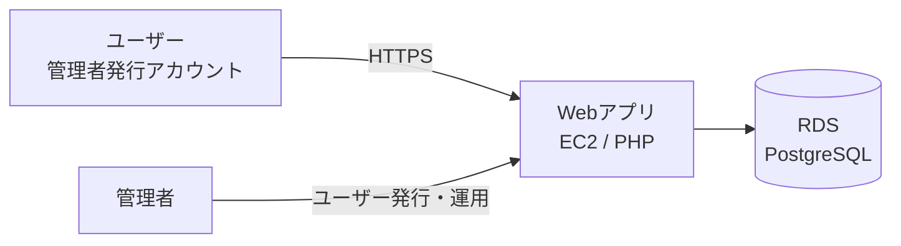

# プロジェクト概要

> このドキュメントは「なぜ作るのか」「誰のために作るのか」「成功とは何か」を定義する最上流文書です。
> ここが曖昧だと以降すべてがぶれます。関係者全員の合意（`Agreed`）が取れるまで下流に進まないこと。

## 1. プロジェクト名
{{プロジェクト名}}

## 2. 背景・解決したい課題
{{現状の課題、なぜ今これを作るのか。定量的に書けると良い（例: 月◯時間の手作業、◯%の問い合わせ）}}

## 3. 目的・ゴール
{{このシステムで達成したいこと}}

## 4. 成功指標（KGI / KPI）
システムの成否を測る指標。リリース後に測定可能な形で定義する。

| 指標 | 定義 | 目標値 | 測定方法 | 測定時期 |
|------|------|--------|----------|----------|
| {{例: 業務処理時間}} | {{}} | {{}} | {{}} | {{}} |

## 5. 対象ユーザー・利用シーン
- 想定ユーザー: {{例: 社内オペレーター / 取引先担当者}}（**管理者が発行したアカウントのみ**）
- 利用環境: {{PC / モバイル、ブラウザ、社内NW / インターネット}}
- 同時利用規模: {{想定ユーザー数・ピーク同時接続数}}

## 6. システム全体像（1枚絵）

{{必要に応じて外部連携システムを追記}}

## 7. 前提・制約（サマリ）
- サーバーサイド: AWS EC2（PHP）+ RDS（PostgreSQL）
- 公開Webアプリ。**サインアップ無し**、管理者発行ユーザーのみログイン可能
- 開発期間: {{◯年}}、規模: DBテーブル {{100超}}
- 詳細は [`06_constraints-assumptions.md`](./06_constraints-assumptions.md)

## 8. マイルストーン（サマリ）
詳細は [`../08_process/01_milestones.md`](../08_process/01_milestones.md)。

| フェーズ | 概要 | 目標時期 |
|---------|------|----------|
| {{PoC / MVP / フェーズ1...}} | {{}} | {{}} |

## 9. 体制・関係者
詳細は [`02_stakeholders-roles.md`](./02_stakeholders-roles.md)。
