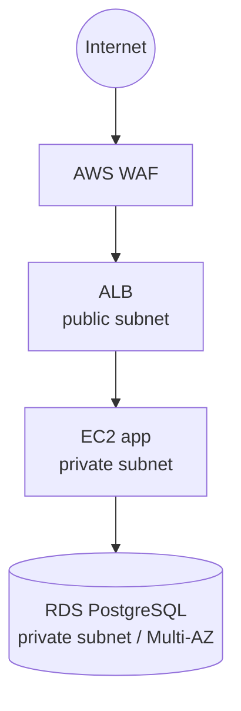

# インフラ構成（EC2 / RDS / ネットワーク）

> インフラは IaC（Terraform / CloudFormation）でコード化し、手動構築は禁止（`rules.md`）。
> 本ドキュメントは設計意図を残す場所。実体は IaC リポジトリ。

## 1. ネットワーク構成

| 項目 | 設定 |
|------|------|
| VPC / サブネット | {{public: ALB, private: EC2/RDS}} |
| リージョン / AZ | ap-northeast-1 / {{2AZ}} |
| 公開範囲 | ALB のみ公開。EC2・RDS は private |

## 2. コンピュート（EC2 / PHP）
| 項目 | 設定 |
|------|------|
| インスタンスタイプ | {{}} |
| OS | {{Amazon Linux 2023}} |
| PHP / Webサーバ | {{PHP 8.x / PHP-FPM + Nginx}} |
| スケーリング | {{Auto Scaling の有無・条件}} |
| デプロイ方式 | {{CodeDeploy / rsync / コンテナ}}、ロールバック手順 |

## 3. データベース（RDS PostgreSQL）
| 項目 | 設定 |
|------|------|
| エンジン / バージョン | PostgreSQL {{}} |
| インスタンスクラス | {{}} |
| マルチAZ | {{有/無}} |
| ストレージ | {{タイプ・容量・自動拡張}} |
| バックアップ | {{自動バックアップ保持日数・スナップショット}} |
| 読み取りレプリカ | {{有/無（性能要件次第）}} |
| 接続管理 | {{コネクションプール / RDS Proxy の採否}} |
| パラメータ | {{タイムゾーン=UTC、ロケール等}} |

## 4. その他のマネージドサービス
| サービス | 用途 | 備考 |
|---------|------|------|
| S3 | {{ファイル保存}} | 任意 |
| CloudWatch | 監視・ログ | 必須 |
| Secrets Manager / SSM | 機密管理 | DB接続情報・APIキー |
| {{ElastiCache}} | {{キャッシュ/セッション}} | 任意 |

## 5. 環境構成
| 環境 | 用途 | 分離方針 |
|------|------|---------|
| 開発（dev） | 開発者検証 | {{}} |
| ステージング（stg） | 受け入れ・リハーサル | 本番相当 |
| 本番（prod） | 本番 | {{}} |

> `.env.production` はソースに置かない。ワークフロー内で SSM / 出力から生成し、値はログに出さない（`rules.md`）。

## 6. コスト概算
月額の見積り。追加課金が発生する構成変更は事前に顧客・PMへ提示する。

| 項目 | 概算（月） | 備考 |
|------|-----------|------|
| EC2 | {{}} | |
| RDS | {{}} | |
| その他 | {{}} | |
