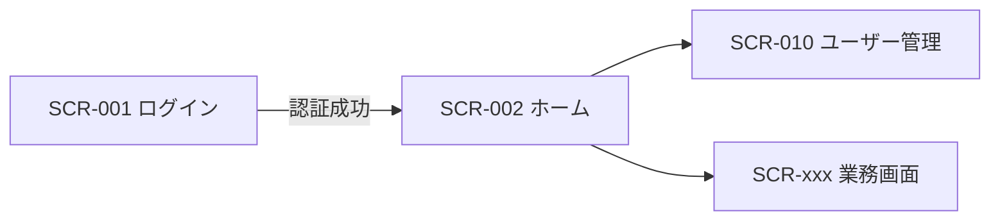

# 画面一覧・画面遷移

> 画面の詳細は `../03_detailed-design/screen/`。ここは全体の一覧と遷移。顧客合意に有効なので早めにプロトタイプと紐づける。

## 1. 画面一覧
| 画面ID | 画面名 | 概要 | アクセス可能ロール | 関連FR | 詳細設計 |
|--------|--------|------|------------------|--------|---------|
| SCR-001 | ログイン | 認証 | 全員（未認証） | FR-AUTH-001 | {{link}} |
| SCR-002 | ホーム / ダッシュボード | ログイン後トップ | 全ロール | {{}} | {{}} |
| SCR-010 | ユーザー管理 | ユーザー発行・停止 | 管理者 | FR-AUTH-002 | {{}} |
| SCR-{{xxx}} | {{業務画面}} | {{}} | {{}} | {{}} | {{}} |

## 2. 画面遷移図

## 3. 共通UI要素
| 要素 | 内容 |
|------|------|
| ヘッダ / ナビ | {{ロールにより表示項目を出し分け}} |
| 権限による表示制御 | 認可NGの機能はメニュー非表示 + サーバ側でも拒否 |
| エラー / 通知表示 | {{トースト / バリデーションメッセージ}} |
| レスポンシブ | {{PC/モバイルのブレークポイント}} |

## 4. 画面とデータ所有権
一覧・詳細画面は、ログインユーザーが参照可能なデータのみを表示する（他ユーザーデータの非表示をUI+APIの両方で担保）。
