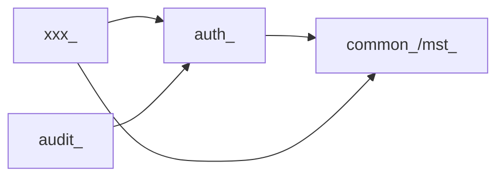

# データ分割・テーブル群の管理方針（テーブル100超対策）

> **このドキュメントは本プロジェクト特有の重要文書**。テーブルが100を超えると、
> 無秩序な設計は「全体を誰も把握できない」状態を招く。ドメイン単位の分割と命名規律で統制する。

## 1. 基本方針
1. **ドメイン（モジュール）単位でテーブルをグルーピングする**。テーブルは必ずどれか1つのドメインに属する。
2. テーブル名に**ドメイン接頭辞**を付け、所属が名前から分かるようにする（例: `auth_users`, `billing_invoices`）。
3. ドメインをまたぐ参照は**明示的に管理**（下記の依存ルール）。循環依存を避ける。
4. 1ドメインのテーブル数が増えすぎたら、サブドメインに再分割を検討する。

## 2. ドメイン一覧（テーブルの住所台帳）
`../03_detailed-design/db/01_table-index.md` と対応。ここはドメインの定義。

| ドメイン | 接頭辞 | 責務 | 想定テーブル数 | オーナー |
|---------|--------|------|--------------|---------|
| 認証・ユーザー | `auth_` | ログイン・権限 | {{}} | {{}} |
| {{業務A}} | `{{xxx_}}` | {{}} | {{}} | {{}} |
| {{業務B}} | `{{yyy_}}` | {{}} | {{}} | {{}} |
| 共通 / マスタ | `mst_` / `common_` | コードマスタ等 | {{}} | {{}} |
| 監査・ログ | `audit_` | 監査証跡 | {{}} | {{}} |

## 3. ドメイン間依存ルール

- 依存は一方向。**循環依存を禁止**。
- 他ドメインのテーブルを直接 JOIN してよいか／サービス経由にするかの方針: {{決定して記載}}
- 外部キーをドメイン境界をまたいで張る範囲: {{方針}}

## 4. 命名・共通カラム規律（詳細は db/00_db-conventions.md）
- 全テーブルに `id`, `created_at`, `updated_at`（必要に応じ `deleted_at`）。
- ユーザー所有データは `user_id`（or `tenant_id`）を必須に。

## 5. 大規模化への対策
| 懸念 | 対策 |
|------|------|
| 性能（巨大テーブル） | インデックス設計、{{パーティショニング（PostgreSQL宣言的パーティション）}}、読み取りレプリカ |
| 把握困難 | テーブル一覧の自動生成（スキーマ→ドキュメント）、ドメイン別ER図 |
| 変更影響 | 外部キー・依存の可視化、マイグレーションレビュー必須 |
| 一貫性 | 共通カラム・命名のCIチェック（{{lint}}） |

## 6. マイグレーション運用
| 項目 | 方針 |
|------|------|
| ツール | {{例: Flyway / Laravel Migration / sqldef}} |
| 命名 | {{タイムスタンプ_説明}} |
| レビュー | スキーマ変更は必ずPRレビュー + 影響範囲明記 |
| ロールバック | {{方針}} |
| 本番適用 | {{無停止 or メンテ枠、手順}} |

## 7. テーブル追加時のチェックリスト
- [ ] 所属ドメインを決め、接頭辞を付けた
- [ ] 共通カラム（id/created_at/updated_at）を入れた
- [ ] 所有者カラム（user_id/tenant_id）の要否を判断した
- [ ] `db/01_table-index.md` に登録した
- [ ] ドメイン間依存ルールに違反していない
- [ ] インデックス・一意制約を定義した
- [ ] テーブル定義テンプレートで詳細設計を書いた
