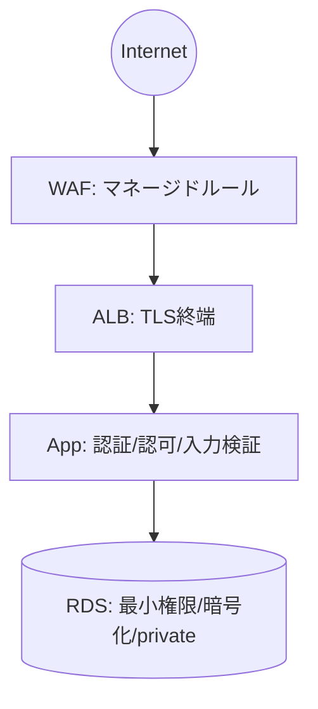

# セキュリティ設計（全体方針）

> インターネット公開 + 管理者発行ユーザー限定という前提で、守るべき方針を一元化する。
> 個別実装のセキュリティ要件は各設計に落とし込み、本書は観点チェックの基準として使う。

## 1. OWASP Top 10 対応方針
各項目に対する本システムの対策を明記する。

| カテゴリ | 対策 | 担保方法（設計/テスト） |
|---------|------|----------------------|
| A01 アクセス制御の不備 | RBAC + データ所有権強制 | 認可テスト・水平権限昇格テスト |
| A02 暗号化の不備 | 全通信TLS、保存時暗号化{{範囲}} | 設定レビュー |
| A03 インジェクション | プレースホルダ/ORM、入力バリデーション | 静的解析・レビュー |
| A04 安全が確認されない設計 | 脅威モデリング | 設計レビュー |
| A05 セキュリティ設定ミス | IaC・最小権限・不要機能無効化 | 構成レビュー |
| A06 脆弱な/古いコンポーネント | 依存のバージョン管理・脆弱性スキャン | CI（{{composer audit 等}}） |
| A07 認証の不備 | 強固な認証・ロックアウト | `02_auth-and-access.md` |
| A08 データ整合性の不備 | 署名検証・デシリアライズ対策 | レビュー |
| A09 ログ/監視の不備 | 監査ログ・アラート | `01_infrastructure.md` |
| A10 SSRF | 外部リクエストの制限 | レビュー |

## 2. 多層防御

| 層 | 対策 |
|----|------|
| ネットワーク | WAF、SG最小化、private subnet、ALBのみ公開 |
| アプリ | 認証・認可・入力バリデーション・出力エスケープ・CSRF対策 |
| データ | 保存時暗号化、最小権限DBユーザー、PIIマスキング |
| 運用 | 監査ログ、監視・アラート、パッチ適用 |

## 3. 機密情報管理
| 情報 | 管理方法 |
|------|---------|
| DB接続情報 | Secrets Manager / SSM Parameter Store |
| APIキー・トークン | 同上。コードにハードコード禁止 |
| PII | {{暗号化・アクセス制限・ログ出力禁止}} |
| 本番設定 | リポジトリに置かない。デプロイ時に注入 |

## 4. 脅威モデリング（STRIDE 観点）
主要機能ごとに脅威を洗い出す。

| 機能 | 脅威（STRIDE） | 対策 |
|------|---------------|------|
| ログイン | なりすまし / ブルートフォース | ロックアウト・MFA・監査 |
| データ参照 | 情報漏洩（他人データ） | 所有権強制・認可テスト |
| {{}} | {{}} | {{}} |

## 5. セキュリティテスト
- 認可テスト（他ユーザーID参照の拒否）を必須化（`../04_quality/01_test-strategy.md`）。
- {{SAST / DAST / 依存脆弱性スキャン}} を CI に組み込む。
- リリース前に {{脆弱性診断 / ペネトレーションテスト}} を実施する（必要に応じ）。

## 6. インシデント対応
| 項目 | 内容 |
|------|------|
| 検知 | {{監視・アラート}} |
| 連絡体制 | {{エスカレーション先}} |
| 対応手順 | {{封じ込め・復旧・報告}} |
