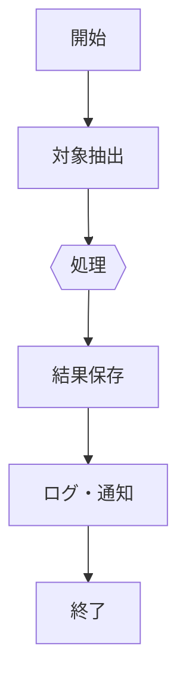

# バッチ / 非同期処理設計: {{BATCH-xxx}} {{名称}}

> 定期バッチ・キュー処理・非同期ジョブを1処理1ファイルで記述。`batch/{{name}}.md`。

## 1. 概要
| 項目 | 内容 |
|------|------|
| ID | {{BATCH-xxx}} |
| 名称 | {{}} |
| 種別 | {{定期バッチ / イベント駆動 / キュー}} |
| 起動方法 | {{cron / スケジューラ / キュー投入}} |
| 実行頻度・契機 | {{毎日 03:00 / 特定イベント}} |
| 冪等性 | {{再実行で副作用が重複しないか}} |
| 関連FR | FR-{{xxx}} |

## 2. 入出力
| 区分 | 内容 |
|------|------|
| 入力 | {{対象テーブル・外部ファイル・キュー}} |
| 出力 | {{更新先・生成物・通知}} |

## 3. 処理フロー

1. {{ステップ詳細}}
2. {{トランザクション境界}}

## 4. エラーハンドリング・リトライ
| 事象 | 挙動 | リトライ | 通知 |
|------|------|---------|------|
| {{一時的エラー}} | {{}} | {{回数・間隔}} | {{}} |
| {{致命的エラー}} | {{中断}} | なし | {{アラート}} |

## 5. 性能・リソース
| 項目 | 内容 |
|------|------|
| 想定件数 | {{}} |
| 実行時間目標 | {{}} |
| 並列度 | {{}} |
| タイムアウト | {{}} |

## 6. 監視・ログ
- 開始/終了/件数/所要時間をログ出力（相関ID付き）。
- 失敗時アラート先: {{}}

## 7. テスト観点
- [ ] 正常処理（代表データ）
- [ ] 冪等性（二重実行）
- [ ] 途中失敗からの復旧・リトライ
- [ ] 大量データでの性能
