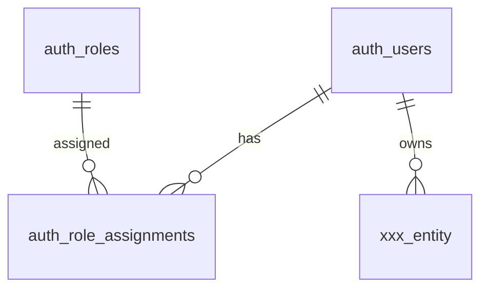

# テーブル一覧（ドメイン別インデックス）

> **全テーブルの住所台帳**。100超のテーブルを俯瞰・検索するための索引。
> テーブルを追加したら必ずここに登録する（`../../02_architecture/06_data-partitioning.md` のチェックリスト）。
> 可能なら本一覧はスキーマから自動生成し、手動との差分をCIで検知する。

## 集計
| 指標 | 値 |
|------|-----|
| 総テーブル数 | {{自動更新}} |
| ドメイン数 | {{}} |
| 最終更新 | YYYY-MM-DD |

---

## ドメイン: 認証・ユーザー（`auth_`）
| テーブル名 | 論理名 | 概要 | 所有者カラム | 詳細設計 | 関連FR |
|-----------|--------|------|------------|---------|--------|
| `auth_users` | ユーザー | ログインユーザー | — | [auth/auth_users.md](./auth/auth_users.md) | FR-AUTH-001 |
| `auth_roles` | ロール | 権限ロール | — | {{}} | — |
| `auth_role_assignments` | ロール割当 | ユーザー×ロール | user_id | {{}} | — |

## ドメイン: {{業務A}}（`{{xxx_}}`）
| テーブル名 | 論理名 | 概要 | 所有者カラム | 詳細設計 | 関連FR |
|-----------|--------|------|------------|---------|--------|
| `{{xxx_...}}` | {{}} | {{}} | user_id | {{}} | FR-{{}} |

## ドメイン: 共通 / マスタ（`mst_` / `common_`）
| テーブル名 | 論理名 | 概要 | 詳細設計 |
|-----------|--------|------|---------|
| `{{mst_...}}` | {{}} | {{}} | {{}} |

## ドメイン: 監査・ログ（`audit_`）
| テーブル名 | 論理名 | 概要 | 詳細設計 |
|-----------|--------|------|---------|
| `audit_logs` | 監査ログ | 重要操作の記録 | {{}} |

---

## ドメイン間関係（概観ER）

> 詳細なER図はドメインごとに分割して管理する（1枚に全テーブルを描かない）。
