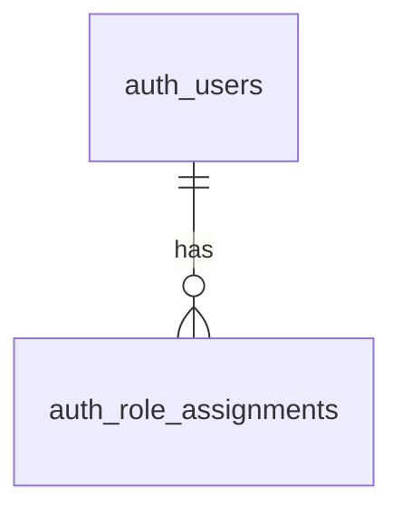

# テーブル定義: `auth_users`（記入例）

> これはテンプレート（`../templates/table-template.md`）の **記入例** です。
> 実テーブルを作るときの粒度・書き方の参考にしてください（内容はサンプルであり要調整）。

## 1. 概要
| 項目 | 内容 |
|------|------|
| 物理名 | `auth_users` |
| 論理名 | ユーザー |
| ドメイン | 認証・ユーザー（`auth_`） |
| 概要 | 本システムにログインするユーザー。管理者が発行する（サインアップ無し） |
| 所有者 | なし（ユーザー自身がルート） |
| 削除方針 | 論理削除（`deleted_at`）。監査のため物理削除しない |
| 想定行数 | 初期 {{100}} / 1年後 {{1,000}} |
| 関連FR | FR-AUTH-001（ログイン）, FR-AUTH-002（ユーザー発行） |

## 2. カラム定義
| # | カラム | 型 | NULL | デフォルト | 一意 | 説明 / 制約 |
|---|--------|-----|:----:|-----------|:----:|------------|
| 1 | `id` | `bigint` IDENTITY | NO | — | PK | 主キー |
| 2 | `email` | `varchar(255)` | NO | — | UQ | ログインID。小文字正規化して保存 |
| 3 | `password_hash` | `varchar(255)` | NO | — | — | ハッシュ化パスワード（argon2id）。平文は保持しない |
| 4 | `display_name` | `varchar(100)` | NO | — | — | 表示名 |
| 5 | `status` | `varchar(20)` | NO | `'active'` | — | `active`/`suspended`。CHECK制約で限定 |
| 6 | `mfa_enabled` | `boolean` | NO | `false` | — | 2段階認証の有効化 |
| 7 | `last_login_at` | `timestamptz` | YES | — | — | 最終ログイン日時 |
| 8 | `created_at` | `timestamptz` | NO | `now()` | — | 作成日時 |
| 9 | `updated_at` | `timestamptz` | NO | `now()` | — | 更新日時 |
| 10 | `deleted_at` | `timestamptz` | YES | — | — | 論理削除日時 |

## 3. 制約・インデックス
| 種別 | 名前 | 対象カラム | 備考 |
|------|------|-----------|------|
| PRIMARY KEY | `pk_auth_users` | `id` | |
| UNIQUE | `uq_auth_users_email` | `email` | 論理削除を考慮した一意性方針は要検討（部分INDEX等） |
| INDEX | `idx_auth_users_status` | `status` | 有効ユーザー絞り込み |
| CHECK | `ck_auth_users_status` | `status` | `status IN ('active','suspended')` |

## 4. リレーション

| 関連テーブル | カーディナリティ | 説明 |
|------------|----------------|------|
| `auth_role_assignments` | 1 : N | ユーザーに割り当てるロール |

## 5. ビジネスルール・不変条件
| ID | ルール |
|----|--------|
| BR-01 | `status = 'suspended'` のユーザーはログインできない |
| BR-02 | `email` はシステム全体で一意（有効ユーザー間） |
| BR-03 | パスワードは必ずハッシュ化して保存（平文禁止） |

## 6. アクセス制御
- 参照・更新できるロール: システム管理者（ユーザー管理機能経由）。一般ユーザーは自分の情報のみ参照/一部更新。
- 本テーブルはユーザーの基点のため所有者カラムは持たないが、他ユーザー情報の参照は認可で制限する。

## 7. DDL（参考）
```sql
CREATE TABLE auth_users (
  id             bigint GENERATED ALWAYS AS IDENTITY PRIMARY KEY,
  email          varchar(255) NOT NULL,
  password_hash  varchar(255) NOT NULL,
  display_name   varchar(100) NOT NULL,
  status         varchar(20)  NOT NULL DEFAULT 'active',
  mfa_enabled    boolean      NOT NULL DEFAULT false,
  last_login_at  timestamptz,
  created_at     timestamptz  NOT NULL DEFAULT now(),
  updated_at     timestamptz  NOT NULL DEFAULT now(),
  deleted_at     timestamptz,
  CONSTRAINT ck_auth_users_status CHECK (status IN ('active','suspended'))
);
CREATE UNIQUE INDEX uq_auth_users_email ON auth_users (email) WHERE deleted_at IS NULL;
CREATE INDEX idx_auth_users_status ON auth_users (status);
```

## 8. テスト観点
- [ ] email の一意制約（論理削除済みを除く）が機能する
- [ ] status の CHECK 制約で不正値を拒否
- [ ] suspended ユーザーはログインできない（BR-01）
- [ ] password_hash に平文が入らない
- [ ] 一般ユーザーが他ユーザーの情報を参照・更新できない（認可）
- [ ] 境界値（email 255文字、display_name 100文字）
