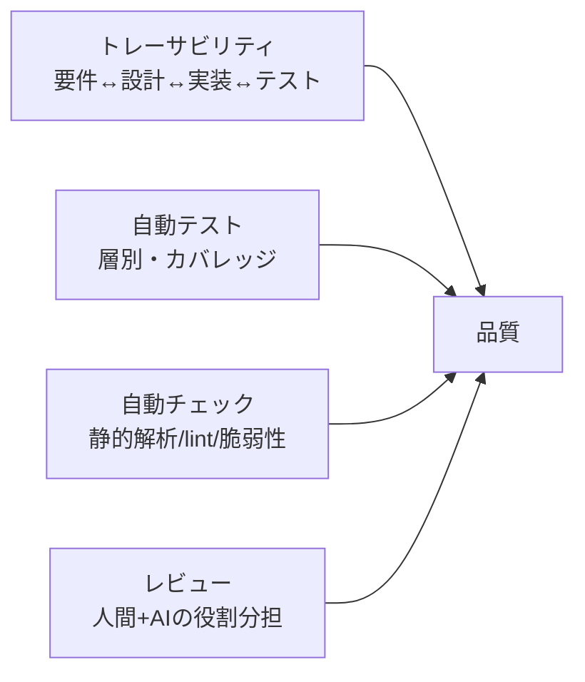

# 品質戦略（全体像）

> 本プロジェクトの最大の前提: **規模が大きく、人間が全コードを読み切れない**。
> よって「人間が全部読んでチェックする」に依存しない品質保証を設計する。
> 鍵は **トレーサビリティ・自動テスト・自動チェック・層別レビュー** の4本柱。

## 1. 品質の4本柱

| 柱 | 目的 | 詳細 |
|----|------|------|
| トレーサビリティ | 「どの要件が実装・検証済みか」を機械的に把握 | `04_traceability.md` |
| 自動テスト | 回帰を自動検知。人力確認を減らす | `01_test-strategy.md` |
| 自動チェック | 規約違反・脆弱性をCIで早期検知 | 本書 第3章 |
| レビュー | 設計意図・要件充足の確認（人間 + AI） | `02_code-review-policy.md`, `03_ai-generated-code.md` |

## 2. 品質ゲート（マージ・リリースの条件）
下流に進む前に満たすべき条件を定義する。満たさなければマージ・リリースしない。

| ゲート | 条件 |
|--------|------|
| PRマージ | 静的解析パス / 全テストグリーン / カバレッジ基準達成 / レビュー承認 / 要件ID紐付け |
| フェーズ完了 | 受け入れ基準達成（`05_acceptance-criteria.md`）/ 顧客合意 |
| 本番リリース | セキュリティチェック / 性能確認 / ロールバック手順確認 |

## 3. 自動チェック（CI）
| チェック | ツール（例） | 必須 |
|---------|------------|:----:|
| コード整形 | {{Pint / PHP-CS-Fixer}} | ✓ |
| 静的解析 | {{PHPStan level ◯ / Psalm}} | ✓ |
| ユニット/機能テスト | {{PHPUnit / Pest}} | ✓ |
| カバレッジ計測 | {{PHPUnit coverage}} | ✓ |
| 依存脆弱性 | {{composer audit}} | ✓ |
| DBスキーマ規約 | {{命名・共通カラムのlint}} | {{}} |
| 秘密情報混入検知 | {{gitleaks 等}} | ✓ |

## 4. 指標（品質メトリクス）
継続的に観測する。

| 指標 | 目標 | 測定 |
|------|------|------|
| テストカバレッジ（重要ロジック） | 80%以上 | CI |
| 重大バグ流出件数 | {{}} | 障害記録 |
| 要件カバー率（Verified/全FR） | 100%（リリース時） | トレーサビリティ表 |
| 静的解析エラー | 0 | CI |

## 5. 役割分担の原則
- **AIエージェント**: コード生成、1次レビュー、テスト生成の補助。
- **人間**: 要件・設計の妥当性判断、受け入れ、最終承認、セキュリティ観点の確認。
- 「AIが書いてAIだけが見た」で終わらせない。重要変更は人間が受け入れ基準で判定する。
