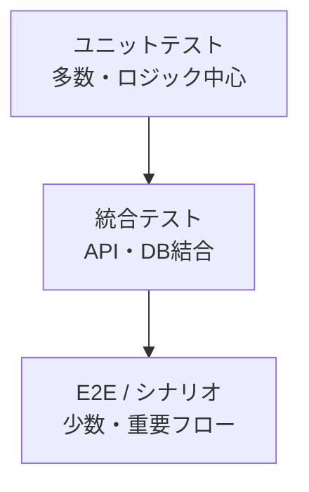

# テスト戦略

> 人間が全コードを追えない以上、**テストが仕様の生きた証明**になる。
> 各詳細設計の「テスト観点」をテストコードに落とし込む。

## 1. テストピラミッド

| 層 | 対象 | ツール（例） | 比重 |
|----|------|------------|------|
| ユニット | ドメインロジック・バリデーション | {{PHPUnit / Pest}} | 多 |
| 統合 | API + DB、リポジトリ | {{PHPUnit + テストDB}} | 中 |
| E2E | 重要ユーザーフロー | {{Playwright / Cypress}} | 少 |

## 2. カバレッジ基準
| 対象 | 基準 |
|------|------|
| 重要ビジネスロジック | 80%以上（`rules.md`） |
| 全体 | {{目標値}} |
| 認可・セキュリティ関連 | 重要パスは必ずテスト |

> カバレッジは目安。**「何を保証したか」が重要**。数字合わせのための無意味なテストは禁止。

## 3. 必須テスト観点（本システム固有）
| 観点 | 内容 |
|------|------|
| 認証 | 無効アカウント拒否、ロックアウト、セッション失効 |
| 認可（垂直） | ロールによる操作可否 |
| 認可（水平） | **他ユーザーのIDを指定しても他人のデータにアクセスできない** |
| 入力検証 | 境界値・不正入力・インジェクション |
| データ所有権 | 一覧・詳細が所有者スコープで絞られる |
| 回帰 | 既存機能を壊していない |

## 4. テストデータ
| 項目 | 方針 |
|------|------|
| 生成 | {{ファクトリ / シーダー}} |
| PII | 実データ禁止。ダミー・マスキング |
| 独立性 | テスト間で状態を共有しない（トランザクションロールバック等） |

## 5. 自動化・CI
- 全テストはCIで実行し、グリーンでなければマージ不可。
- E2Eは{{nightly / リリース前}}に実行。
- フレーク（不安定）テストは隔離し修正する。

## 6. 非機能テスト
| 種別 | 内容 | 時期 |
|------|------|------|
| 性能 | NFR-PERF の目標検証（{{負荷ツール}}） | フェーズ末 / リリース前 |
| セキュリティ | 認可・脆弱性スキャン・{{診断}} | リリース前 |

## 7. テスト作成ルール（AI含む）
- 新機能・バグ修正には対応テストを**同時に**作成する。
- テストは詳細設計の「テスト観点」を網羅する。
- バグ修正時は、再発防止の回帰テストを必ず追加する。
