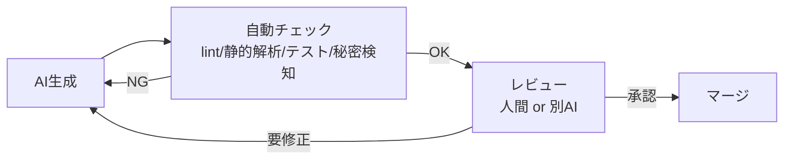

# AI生成コードの検証ルール

> 本プロジェクトはAIエージェントがコードを大量に生成する前提。
> 「AIが書いた＝信頼できる」ではない。**AI生成物も人間の成果物と同じ品質ゲートを通す**。
> 加えて、AI特有のリスク（仕様の勝手な補完、幻覚、既存コードとの不整合）に対策する。

## 1. AI生成の前提ルール
1. 作業前に対象の設計ドキュメントと `rules.md` を読ませる。
2. **仕様にないことを勝手に決めさせない**。不足・矛盾は実装を止めて質問 or 前提明記で提案。
3. 生成コードは必ず対応するFR/設計IDに紐づける（コメント or PR説明）。
4. テストを同時生成させる（`01_test-strategy.md`）。
5. 設計に影響する変更は、設計ドキュメントの更新も提案させる。

## 2. AI特有リスクと対策
| リスク | 対策 |
|--------|------|
| 仕様の勝手な補完 | 空欄＝未決定。質問を促すプロンプト・レビューで検出 |
| 幻覚（存在しないAPI/テーブル参照） | ビルド・テスト・静的解析で機械的に検出 |
| 既存コードとの不整合 | 関連コードを読ませる。重複実装をレビューで検出 |
| セキュリティ軽視 | セキュリティ観点を必須レビュー項目に |
| 過剰実装（スコープ外） | スコープ・受け入れ基準を提示。差分レビュー |
| 機密情報のハードコード | 秘密情報検知（gitleaks等）+ レビュー |

## 3. 検証フロー

- **自動チェックを通過しただけでは不可**。要件充足を人間 or 別エージェントが確認。
- 高リスク変更（認証/認可/課金/削除/スキーマ）は**人間レビュー必須**（`02_code-review-policy.md`）。

## 4. AIによるレビュー（2次活用）
- 生成とは別のセッション/モデルでレビューさせると、見落としを減らせる。
- AIレビューの指摘も人間が取捨選択する（AIの指摘を鵜呑みにしない）。

## 5. 受け入れ判定
AI生成コードは、`05_acceptance-criteria.md` の受け入れ基準を満たして初めて「完了」とする。
「ビルドが通る」「それらしく動く」は完了条件ではない。

## 6. LLM機能を実装する場合の追加対策
本システム自体がLLMを使う機能を持つ場合:
- プロンプトインジェクション対策（入力バリデーション・サニタイズ）を実装。
- 学習データ再利用なし（オプトアウト）の設定を確認。
- 外部に送るデータに機密・PIIを含めない設計。
