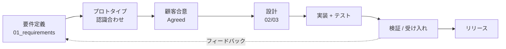

# 開発プロセス（仕様駆動開発 × プロトタイピング）

> 大規模・長期・要件が流動的、という前提に合わせたプロセス。
> 「仕様を確定 → プロトタイプで検証 → 合意 → 実装 → 検証」のサイクルを、フェーズ単位で回す。

## 1. 全体の流れ

## 2. 原則
1. **仕様が先、コードが後**。`Agreed` でない要件は本実装に進めない。
2. **プロトタイプで早期に認識を合わせる**。文章で伝わらないものは動くモックで見せる。
3. **プロトタイプと本実装を区別する**。プロトタイプは品質基準を満たさなくてよいが、本実装に昇格する際は品質ゲートを通す。
4. **小さく区切る**。フェーズ・イテレーションで価値を刻む。一括ビッグバンを避ける。
5. **決定を記録する**（ADR）。

## 3. イテレーション（反復）の進め方
1イテレーション（{{例: 2週間}}）の流れ:
| ステップ | 内容 | 成果物 |
|---------|------|--------|
| 計画 | 対象FRの選定・優先度 | イテレーション計画 |
| 仕様詰め | 要件・設計を確定（必要ならプロトタイプ） | 設計Doc（Agreed） |
| 実装 | AI + 人間で実装・テスト | PR |
| 検証 | 受け入れ基準で確認 | テスト結果・RTM更新 |
| レビュー | デモ・振り返り | 議事録・改善 |

## 4. プロトタイピングの位置づけ
| 目的 | 使い方 |
|------|--------|
| 要件の認識合わせ | 画面モック・クリッカブルプロトタイプを顧客に見せる |
| 技術検証（PoC） | 性能・実現性のリスクを早期に潰す |
| ブランチ | `prototype/*` を使い、検証後は破棄。本実装に流用する場合は品質ゲートを通す |

## 5. 役割と作業分担
| 役割 | 主担当 |
|------|--------|
| 要件・合意形成 | PM/PdM + 顧客 |
| 設計 | アーキテクト + 開発者 |
| 実装・テスト | 開発者 + AIエージェント |
| レビュー・品質 | 開発者 + 人間レビュア（高リスクは必須） |
| 受け入れ | 顧客 + PM |

## 6. AIエージェントのプロセス内での使い方
- 要件・設計が `Agreed` の範囲でのみ実装させる。
- タスクは `04_quality/03_ai-generated-code.md` のルールで検証する。
- 大きな機能は「設計 → 実装 → レビュー」のステップに分けて依頼する。

## 7. 定例・コミュニケーション
| 会議 | 頻度 | 目的 | 記録 |
|------|------|------|------|
| イテレーション計画 | {{隔週}} | スコープ確定 | 計画表 |
| デイリー同期 | {{毎日/任意}} | 進捗・障害共有 | — |
| デモ / 受け入れ | フェーズ末 | 顧客確認・合意 | 議事録 + チェックリスト |
| 振り返り | イテレーション末 | 改善 | 振り返りメモ |
