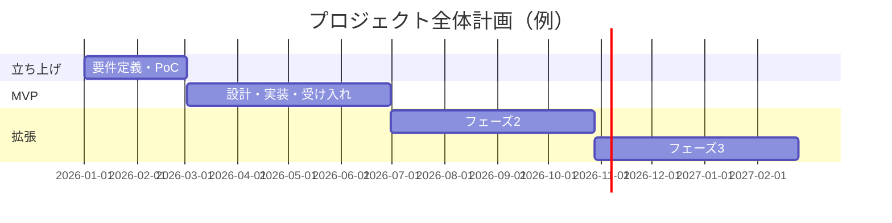

# マイルストーン・フェーズ計画

> 1年以上の長期プロジェクト。価値を刻んでリリースし、各フェーズ末で合意・振り返りを行う。

## 1. フェーズ全体像

## 2. マイルストーン一覧
| MS | 名称 | 目的 / ゴール | 主要成果物 | 完了条件（Exit） | 目標時期 |
|----|------|--------------|-----------|-----------------|----------|
| MS-0 | 立ち上げ | 要件合意・最大リスク検証（PoC） | 要件Doc(Agreed)、PoC結果、アーキ方針 | スコープ・方式合意 | {{}} |
| MS-1 | MVP | 最小で価値提供 | 動作するコア機能・受け入れ合格 | フェーズDone（`../04_quality/05_acceptance-criteria.md`） | {{}} |
| MS-2 | フェーズ2 | 機能拡張 | {{}} | {{}} | {{}} |
| MS-3 | フェーズ3 | {{}} | {{}} | {{}} | {{}} |

## 3. フェーズごとの計画テンプレート
各フェーズ開始時に埋める。
| 項目 | 内容 |
|------|------|
| スコープFR | {{FR-IDリスト}} |
| 非機能の重点 | {{性能/セキュリティ等}} |
| リスク | {{}} |
| 完了条件 | {{受け入れ基準}} |
| 合意ポイント | {{顧客合意のタイミング}} |

## 4. リリース計画
| リリース | 対象フェーズ | 環境 | 承認者 | 備考 |
|---------|------------|------|--------|------|
| {{R1}} | MVP | 本番 | 顧客 | {{}} |

## 5. 進捗の見える化
- トレーサビリティ表（`../04_quality/04_traceability.md`）でFRの実装・検証状況を可視化。
- フェーズ末に「スコープ内FRのVerified率」をレビューする。
