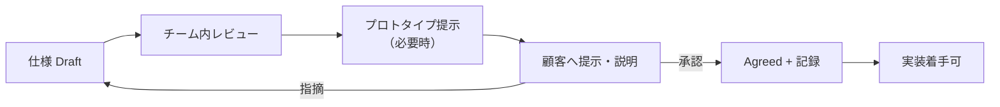

# 顧客との合意の取り方

> 認識齟齬を防ぐ最大のポイントは「何を・いつ・どう合意するか」を事前に決めておくこと。
> 口頭やチャットの曖昧な了承を「合意」としない。**合意は記録に残して初めて成立**。

## 1. 合意の対象と単位
| 合意対象 | 単位 | 合意者 | 記録先 |
|---------|------|--------|--------|
| プロジェクト目的・スコープ | 全体 | 顧客（意思決定者） | `01_requirements` を `Agreed` |
| 要件（FR/NFR） | FR単位 / フェーズ単位 | 顧客（業務+意思決定） | 要件Docのステータス + 議事録 |
| 画面・UX | 画面単位 | 顧客 | プロトタイプ確認記録 |
| フェーズ完了・受け入れ | フェーズ | 顧客 | 受け入れチェックリスト |
| 変更 | 変更要求単位 | 顧客 | 変更要求票（CR） |

## 2. 合意フロー

## 3. 合意を取る際のルール
1. 合意対象を**事前に明文化**して提示する（口頭説明だけで合意を取らない）。
2. **プロトタイプ・画面モック**を使い、動くもので認識を合わせる。
3. 合意事項・保留事項・宿題を**議事録**に残し、関係者に共有・確認する（`templates/meeting-minutes-template.md`）。
4. 合意できたら、該当ドキュメントのステータスを `Agreed` に更新し、日付・合意者を記録する。
5. 合意後の変更は、必ず**変更管理フロー**（`03_change-management.md`）を通す。

## 4. 認識齟齬を防ぐ工夫
| 工夫 | 内容 |
|------|------|
| 用語統一 | `glossary.md` を顧客とも共有 |
| 可視化 | 画面遷移図・ER図・プロトタイプ |
| 受け入れ基準の事前共有 | Given/When/Then を合意時に提示（`../04_quality/05_acceptance-criteria.md`） |
| スコープ外の明示 | 「やらないこと」も合意する（`../01_requirements/01_scope.md`） |
| 定期デモ | 作ったものを早期・頻繁に見せる |

## 5. 合意記録フォーマット（最低限）
| 項目 | 内容 |
|------|------|
| 日付 | YYYY-MM-DD |
| 合意対象 | {{FR-ID / フェーズ / 変更ID}} |
| 合意者 | {{顧客名・役割}} |
| 合意内容 | {{}} |
| 保留・宿題 | {{期限付き}} |
| 記録者 | {{}} |
