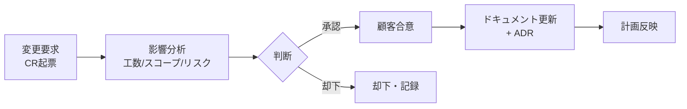

# 変更管理フロー

> 長期プロジェクトでは要件・仕様は必ず変わる。変更そのものは悪ではない。
> **「無管理の変更」が悪**。変更を記録・評価・合意するプロセスで、スコープと品質を守る。

## 1. 変更管理の対象
`Agreed` または `Frozen` になった以下への変更:
- 要件（FR/NFR）・スコープ
- アーキテクチャ・技術スタック
- 画面・API・DBスキーマの設計意図
- マイルストーン・リリース計画

> まだ `Draft` の内容の修正は通常の更新でよい（変更管理不要）。

## 2. 変更管理フロー

## 3. 各ステップ
| ステップ | 内容 | 担当 |
|---------|------|------|
| 起票 | 変更要求票（CR）を作成（`templates/change-request-template.md`） | 起票者 |
| 影響分析 | 影響範囲・工数・スケジュール・リスク・コストを評価 | 開発/PM |
| 判断 | 対応要否・優先度・フェーズ配置を決定 | PM + 顧客 |
| 合意 | 顧客合意（コスト/納期への影響含む）（`02_agreement-flow.md`） | 顧客 |
| 反映 | 関連ドキュメント更新、必要ならADR記録、計画反映 | 担当 |

## 4. 影響分析の観点
- 影響するFR / 設計Doc / テーブル / API / 画面（トレーサビリティ表で追跡）
- 工数・スケジュール影響
- 既存機能への回帰リスク
- セキュリティ・性能への影響
- コスト影響（月額$1以上の追加や課金発生は必ず顧客提示）

## 5. 変更要求（CR）管理台帳
| CR-ID | 概要 | 起票日 | 影響度 | 状態 | 合意日 | 反映先 |
|-------|------|--------|:------:|------|--------|--------|
| CR-001 | {{}} | {{}} | {{高/中/低}} | {{起票/分析/合意/反映/却下}} | {{}} | {{FR-ID等}} |

## 6. 緊急変更
障害対応などの緊急変更は、先に対応し**事後にCRで記録・合意**する。無記録にしない。
